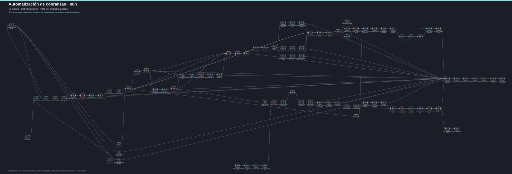
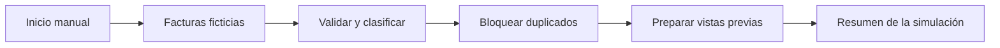

# Automatización de cobranzas con n8n

**Portfolio de David Miño · Demostración simplificada · Datos ficticios**

Una muestra de cómo organizar facturas, aplicar reglas de revisión y preparar vistas previas de recordatorios. Combina lógica de negocio, automatización y controles de datos.

Esta demo fue preparada con asistencia de IA a partir de un proyecto de automatización de cobranzas. El sistema operativo, sus configuraciones y la información de la empresa no forman parte de este repositorio.

## Qué muestra

- Separación de facturas pagadas, vencidas, futuras y en revisión manual.
- Validación de datos antes de generar una vista previa.
- Bloqueo de registros duplicados dentro del mismo lote.
- Uso de referencias de contacto ficticias, sin números de teléfono.
- Resumen de resultados y mensajes de ejemplo, sin realizar envíos.

## Flujo



**Tecnologías de esta demo:** n8n, JavaScript, Node.js y JSON.

En el proyecto de origen se trabajó con n8n, PostgreSQL y Google Sheets, además de pruebas controladas de WhatsApp. Esta versión pública reproduce una parte acotada de la lógica sin conectarse a esos servicios. No es una exportación del sistema de la empresa.

## Probar en tu computadora

Requiere una versión mantenida de Node.js 22 o posterior. No requiere instalar paquetes, abrir puertos ni proporcionar claves.

```bash
node src/demo.mjs
node --test tests/demo.test.mjs
node tools/verify-publication.mjs
```

La fecha de referencia está fijada en `2026-01-15` para que los resultados sean reproducibles.

| Resultado esperado | Cantidad |
|---|---:|
| Registros ficticios de entrada | 8 |
| Vistas previas de recordatorios | 2 |
| Registros bloqueados por duplicación | 2 |
| Mensajes enviados | 0 |
| Solicitudes de red | 0 |

La detección de duplicados se limita al lote actual. No implementa persistencia, bloqueo entre ejecuciones ni garantías de idempotencia en producción.

## Abrir el flujo en n8n

1. Usar una instancia de desarrollo con una cuenta sin credenciales de producción.
2. Importar `workflows/cobranzas-demo.n8n.json` como un workflow nuevo.
3. Revisar sus seis nodos: un inicio manual y cinco nodos Code.
4. Ejecutar manualmente y consultar la salida de `Resumen`.

El archivo se entrega con `active: false`. No incluye Schedule, Webhook, HTTP Request ni conectores de servicios. No solicita credenciales ni realiza envíos. La estructura y el JavaScript fueron comprobados localmente; la importación y ejecución dentro de una instancia de n8n quedan pendientes de comprobar.

Los nodos Code usan JavaScript puro, sin módulos externos. El comportamiento de la demo se comprueba con las pruebas de Node.js.

## Recorrido del repositorio

| Archivo | Contenido |
|---|---|
| `src/rules.mjs` | Reglas de validación, clasificación, duplicados y vistas previas |
| `src/demo.mjs` | Ejecución local reproducible |
| `examples/facturas.demo.json` | Ocho registros exclusivamente ficticios |
| `workflows/cobranzas-demo.n8n.json` | Flujo manual de demostración |
| `tests/demo.test.mjs` | Casos de negocio y controles de la exportación |
| `tools/build-workflow.mjs` | Generador reproducible del flujo n8n |
| `tools/verify-publication.mjs` | Control de archivos y señales de información sensible |
| `SECURITY.md` | Alcance de la revisión y medidas para publicar |

## Alcance profesional

Esta muestra permite conversar sobre automatización, validación de datos, seguimiento de estados y revisión manual de excepciones. Los controles presentados son parte de una demo educativa; no sustituyen la revisión de un sistema productivo.

## Privacidad

Todos los clientes, importes, facturas y contactos de los ejemplos son inventados. No se incluyen marcas de clientes, credenciales, IDs de instancias, enlaces internos, respaldos ni historial del proyecto original.

Antes de publicar o incorporar nuevos archivos, consultar [SECURITY.md](SECURITY.md). Las verificaciones automáticas reducen riesgos conocidos; no garantizan por sí solas ausencia de información sensible.
